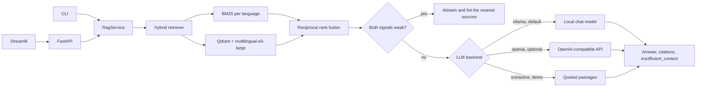
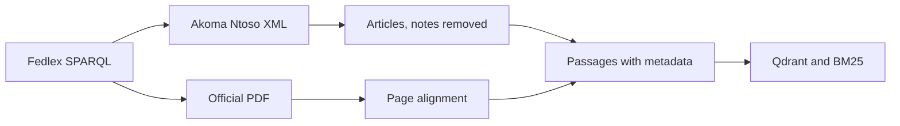
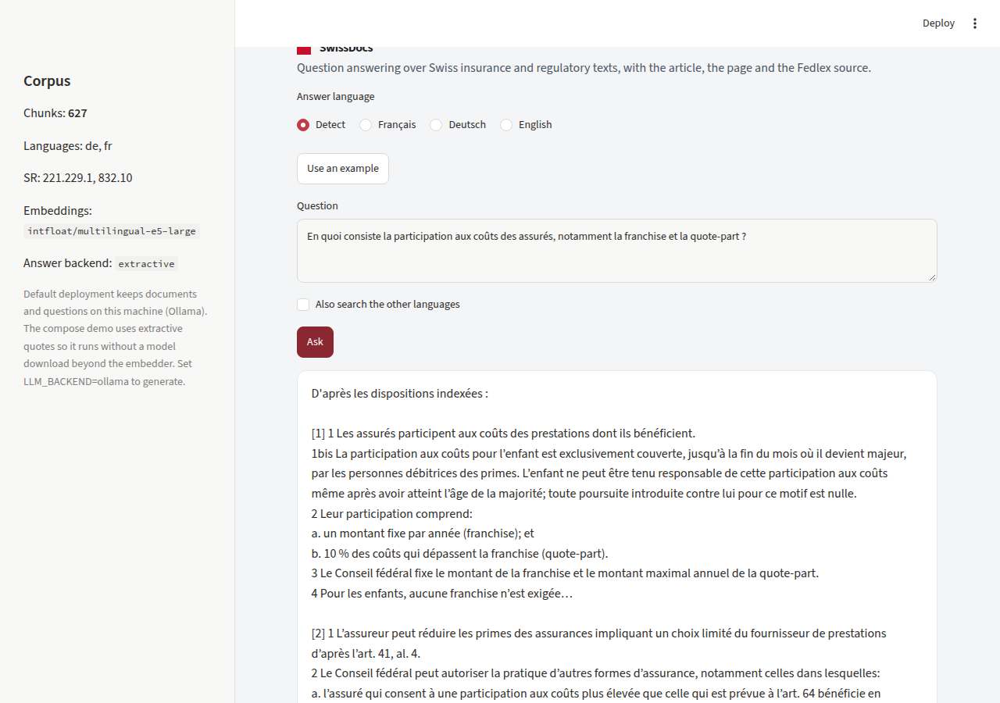

# SwissDocs RAG

SwissDocs answers questions about Swiss insurance legislation in French, German or English, and cites the statute, the article, the page and the Fedlex consolidation it used.

It is a portfolio project by David Ouchtar. It is a research demo, not a product of the Swiss Confederation and not legal advice.

## Résumé

Les collaborateurs des assureurs, fiduciaires et PME perdent du temps à chercher une réponse dans les conditions et les lois, publiées en français et en allemand. SwissDocs interroge la LAMal (SR 832.10, état au 1er juillet 2026) et la LCA (SR 221.229.1, état au 1er janvier 2024). La réponse est dans la langue de la question et cite l'article, la page et la version. Les embeddings, et par défaut le modèle de langue, tournent sur la machine (argument nLPD). Fedlex ne publie pas de consolidation anglaise téléchargeable pour ces deux actes : une question en anglais est répondue à partir des textes officiels FR/DE.

## Kurzfassung

Mitarbeitende von Versicherern, Treuhändern und KMU suchen Antworten in Gesetzestexten, die auf Deutsch und Französisch vorliegen. SwissDocs durchsucht das KVG (SR 832.10, Stand 1. Juli 2026) und das VVG (SR 221.229.1, Stand 1. Januar 2024). Die Antwort folgt der Sprache der Frage und nennt Artikel, Seite und Fassung. Embeddings und standardmässig das Sprachmodell laufen lokal (nDSG). Für diese beiden Erlasse gibt es auf Fedlex keine herunterladbare englische Fassung; englische Fragen werden aus dem amtlichen deutschen und französischen Text beantwortet.

## Problem

People who work with Swiss health insurance or with private insurance contracts need a specific article, not a general summary. The binding texts are the French and German consolidations on [Fedlex](https://www.fedlex.admin.ch). English questions are common in international teams, but the Confederation does not currently publish a downloadable English consolidation of these two acts. A useful assistant has to answer in the reader's language, point at the official article, and say when the corpus does not contain the fact.

## What this repository does

- Downloads the latest *applicable* Fedlex consolidation (versions dated in the future are ignored) via the public SPARQL endpoint, parses the Akoma Ntoso XML, and drops amendment notes so retrieval sees the operative text.
- Splits long articles into overlapping passages that keep the statute, article, language, version and, when the official PDF can be aligned, the page.
- Embeds passages locally with `intfloat/multilingual-e5-large` (ONNX, via FastEmbed) and stores them in Qdrant. A BM25 index is built per language.
- Fuses the two rankings with reciprocal rank fusion. Ties break on the dense score, then BM25, then the chunk id, so a repeated run does not reshuffle equal scores.
- Answers with a pluggable backend. The library default is [Ollama](https://ollama.com), so the question and the retrieved passages stay on the machine. An OpenAI-compatible endpoint is optional. The Docker demo uses an extractive backend that quotes the retrieved articles, so it runs without a multi-gigabyte chat model.
- Returns citations and sets `insufficient_context` when retrieval is empty or both signals are weak. The measured behaviour of that gate is in the evaluation section. It is not a substitute for reading the statute.

Insurers' general terms are copyrighted and are not in this repository. Point `CUSTOM_CORPUS_PATH` at a private JSONL in the same schema if you are allowed to index them. Those files stay local.

## Architecture



Ingestion is separate from the request path:



## Demo

The screenshot below is the extractive demo: a French question about cost-sharing, the quoted article, and the Fedlex citation (LAMal art. 64, page 52, version 2026-07-01).



Open the UI at `http://localhost:8501` after `docker compose up --build`. The API is at `http://localhost:8000/docs`.

## Quickstart

Python 3.12 is what the lockfile, Docker image and CI use. The code itself uses 3.11 syntax; NumPy 2.5 in `requirements.txt` requires 3.12.

```bash
python3.12 -m venv .venv
source .venv/bin/activate
pip install -r requirements.txt
pip install -e . --no-deps
cp .env.example .env
make test
```

Refresh the corpus from Fedlex, then re-index:

```bash
make download
make ingest
```

`data/sample/chunks.jsonl` is the corpus this commit was evaluated on, so the demo works without calling Fedlex again. `make download` rewrites it.

Ask from the terminal, the API, or the UI:

```bash
python -m swissdocs.cli ask "Dans quel délai les créances du contrat d'assurance se prescrivent-elles ?" --language fr
make api          # http://localhost:8000
make ui           # http://localhost:8501
```

The first index build downloads multilingual-e5-large (about 2.2 GB) and embeds the 627 passages. On CPU that took about three minutes in the evaluation environment.

### One-command demo

```bash
docker compose up --build
```

- Qdrant on port 6333
- API on port 8000, with `LLM_BACKEND=extractive`
- UI on port 8501

The first API start downloads the embedding model into the `embed_cache` volume and builds the index before it serves traffic. The UI waits and says so.

### Local generation with Ollama

This is the configuration to use when the passages must not leave the organisation.

```bash
ollama pull qwen2.5:7b
```

In `.env`:

```bash
LLM_BACKEND=ollama
OLLAMA_BASE_URL=http://localhost:11434
OLLAMA_MODEL=qwen2.5:7b
```

From Docker, point `OLLAMA_BASE_URL` at the host, for example `http://host.docker.internal:11434`, and set `LLM_BACKEND=ollama` on the API service.

An OpenAI-compatible backend is opt-in. It sends the question and the retrieved passages to that provider. Leave `OPENAI_API_KEY` empty unless you mean to do that.

```bash
LLM_BACKEND=openai OPENAI_API_KEY=... python scripts/evaluate.py --generation
```

Generation metrics were not measured in this environment: no Ollama daemon and no API key were available. The command above is how to produce them. Do not copy numbers from anywhere else into the table below.

## Evaluation

Gold set: 24 answerable questions (8 French, 8 German, 8 English) written against the committed texts, plus 4 off-topic probes and 2 near-miss probes. English gold labels accept either the French or the German article, because that is what the index contains. A hit is the first retrieved passage whose statute, language and article match a gold label. Hit@5 and MRR use that rank. The script is `scripts/evaluate.py`. The raw rows, including scores, are in [`data/eval/results.json`](data/eval/results.json).

Measured on 18 November 2026 with `intfloat/multilingual-e5-large`, 627 passages, `min_dense_score=0.78`, no generative model.

| Retriever | Language | n | Hit@1 | Hit@5 | MRR |
| --- | --- | ---: | ---: | ---: | ---: |
| BM25 | fr | 8 | 0.8750 | 1.0000 | 0.9375 |
| BM25 | de | 8 | 1.0000 | 1.0000 | 1.0000 |
| BM25 | en | 8 | 0.1250 | 0.2500 | 0.1562 |
| BM25 | all | 24 | 0.6667 | 0.7500 | 0.6979 |
| Dense e5-large | fr | 8 | 0.7500 | 1.0000 | 0.8438 |
| Dense e5-large | de | 8 | 0.7500 | 1.0000 | 0.8438 |
| Dense e5-large | en | 8 | 0.6250 | 0.7500 | 0.6667 |
| Dense e5-large | all | 24 | 0.7083 | 0.9167 | 0.7847 |
| Hybrid RRF | fr | 8 | 0.8750 | 1.0000 | 0.9375 |
| Hybrid RRF | de | 8 | 1.0000 | 1.0000 | 1.0000 |
| Hybrid RRF | en | 8 | 0.7500 | 0.7500 | 0.7500 |
| Hybrid RRF | all | 24 | 0.8750 | 0.9167 | 0.8958 |

Hybrid RRF is the default. It is the best of the three on Hit@1 and MRR. BM25 is already excellent in German and French, and close to useless in English, because the questions and the statutes do not share tokens. The dense model is what makes English questions usable. Fusion keeps the lexical precision of BM25 on French and German (German Hit@1 moves from 0.75 dense-only to 1.00).

Two English questions are outside the top 5. "Deductible and coinsurance" does not land on LAMal art. 64, which says *franchise* and *quote-part* / *Franchise* and *Selbstbehalt*. "Limitation period" does not land on LCA/VVG art. 46, which says *prescription* / *Verjährung*. The French question on sickness benefits is rank 2 rather than rank 1 because art. 31 (dental care) opens with the same sentence as art. 25. These are reported as misses, not relabelled.

Extractive answers, still without a generative model:

| Check | Result |
| --- | ---: |
| In-scope answers that cite a gold article | 0.9167 |
| In-scope answers wrongly marked insufficient | 0.0000 |
| Off-topic probes marked insufficient | 0.0000 |
| Near-miss probes marked insufficient | 0.0000 |

The abstention rule is: flag the answer when the best dense score is below 0.78 **and** the best BM25 score is 0. On this set it never fired. Off-topic questions still share ordinary words with the statutes ("capital" in the life-insurance provisions, "moitié" in the rule that several children's deductibles are halved). Near-misses behave as designed for retrieval and badly for abstention: "the ordinary deductible in francs" correctly surfaces art. 64, which tells the Federal Council to set the amount and does not state the amount. The extractive backend quotes that article and does not abstain. A chat model is supposed to say that the figure is not in the context. That path is implemented and covered by a scripted unit test. It was not measured with a live model here. RAGAS was not run.

## Design choices

**Local embeddings, local model by default.** The statutes are public, but a real deployment also indexes contracts and internal notes. Computing embeddings on the machine, and calling Ollama rather than a third-party chat API, is the concrete nLPD argument: the question and the retrieved text do not leave the operator's infrastructure unless someone opts in. The README and `.env.example` say when the OpenAI path sends data out.

**French and German only, in the index.** Those are the binding languages, and they are the files Fedlex actually serves for SR 832.10 (1 July 2026) and SR 221.229.1 (1 January 2024). An English question is detected or selected in the UI and searched across both official languages. The extractive English template says so, and every citation carries the language, the version date and a Fedlex link.

**Article-shaped chunks.** Lawyers cite articles. Passages keep the article id, the marginal title, the chapter path and the page. Authorial notes ("nouvelle teneur selon...") are removed so they do not outrank the rule.

**Hybrid retrieval rather than a cross-encoder.** BM25 already supplies the lexical signal, which is the right one for article numbers and defined terms in French and German. A multilingual cross-encoder would be the next stage for the English terminology gap. It is not in the default image, because it is a second large model and this corpus is small enough that fusion already moves Hit@1 from 0.71 to 0.88.

**Extractive demo, Ollama for a real answer.** `docker compose up` has to answer with citations on a laptop that has no GPU and no model weights beyond the embedder. Quoting the passage is honest. Switching `LLM_BACKEND` does not change retrieval.

## Limitations and what I would do next

- Two acts, not the classified compilation. The deductible in francs and the premium live in ordinances and in the insurer's tariff, not in art. 64 LAMal. Indexing KVV/OAMal is the obvious extension, still from Fedlex.
- English legal synonyms are a real miss, as the table shows. A small maintained glossary, or a multilingual reranker, is the remedy. I would measure it on a held-out set rather than on these 24 questions.
- The abstention gate does not separate this probe set. I would not tune 0.78 until the gap is visible on questions that were not used to pick it. Until then, treat `insufficient_context` from the extractive backend as weak, and rely on the model prompt once Ollama is running.
- Page alignment failed for a minority of articles (see `pages_mapped` in `data/sample/manifest.json`). Citations then omit the page instead of inventing one.
- No authentication, no rate limit, no audit log. Fine for a local demo, not fine as a shared internal tool.
- Italian is an official language of the Confederation and is not indexed.
- Nothing here is legal advice. The Fedlex consolidation wins if this corpus and the website disagree.

## Layout

| Path | Role |
| --- | --- |
| `src/swissdocs/ingest` | Fedlex download, Akoma Ntoso parser, PDF pages, chunking |
| `src/swissdocs/retrieval` | Embeddings, Qdrant, BM25, RRF |
| `src/swissdocs/generation` | Ollama, OpenAI-compatible, extractive answers |
| `src/swissdocs/api.py` | FastAPI |
| `apps/streamlit_app.py` | Demo UI |
| `scripts/download_corpus.py` | Rebuild the sample from Fedlex |
| `scripts/evaluate.py` | Hit rate, MRR, extractive checks |
| `data/sample` | Committed corpus and source manifest |
| `data/eval` | Gold questions and measured results |
| `tests` | Parser, fusion, API. The LLM is scripted. No model download. |

```bash
make lint
make test
make eval
```

## License and sources

MIT License, copyright David Ouchtar. See [LICENSE](LICENSE).

The legislative texts were downloaded from Fedlex, the publication platform of the Swiss Federal Chancellery. Official enactments are not protected by copyright (art. 5 of the Copyright Act, LDA/URG). This project is not affiliated with the Confederation. English wording in the UI is a description of those texts, not an official translation.

## Author

David Ouchtar. MSc AI student at UniDistance Suisse. Founder of Dolus AI, Le Mont-sur-Lausanne.
